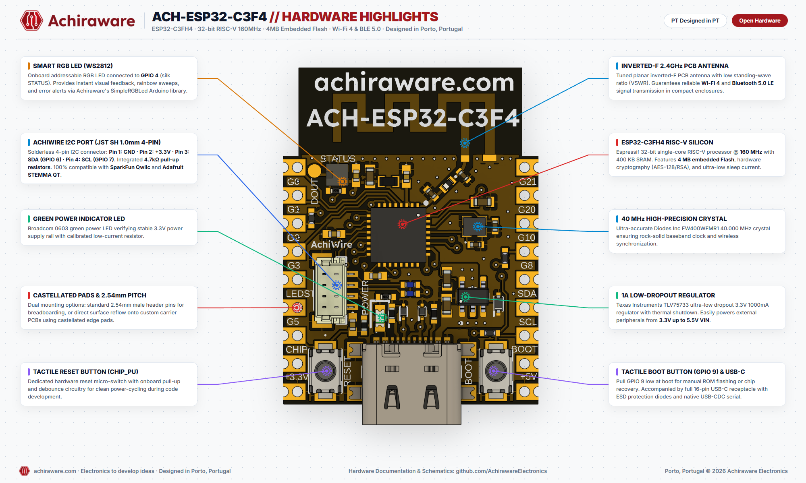
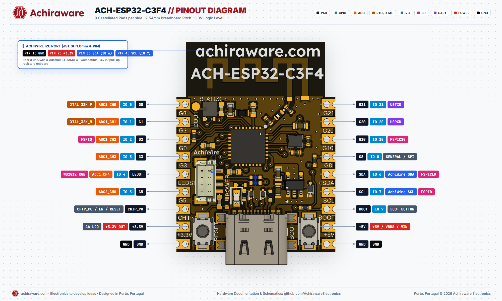

<div align="center">

# ACH-ESP32-C3F4

**Ultra-Compact RISC-V ESP32-C3 Development Board with 4MB Flash, Wi-Fi 4, BLE 5 & Solderless I2C**

[](#hardware-files)
[](https://achiraware.com)
[](https://achiraware.com)
[](#quickstart-guide)
[](https://achiraware.com/product/ach-esp32-c3f4-prototype-board/)

<br>



</div>

---

## 📖 Overview

The **ACH-ESP32-C3F4** by **Achiraware Electronics** is a miniature, ultra-efficient IoT development board built around the **Espressif ESP32-C3FH4** open-standard 32-bit RISC-V microcontroller @ **160 MHz**. Handcrafted and designed in Vila Nova de Gaia / Porto, Portugal, it delivers modern wireless connectivity in a featherweight form factor with exceptional power efficiency and rock-solid hardware security.

Designed for wearable devices, compact battery-powered sensors, smart home nodes, and industrial telemetry, it features integrated **4 MB Flash**, native **Wi-Fi 4 & Bluetooth 5.0 LE**, an ultra-low noise **1000 mA (1A) LDO regulator**, and our signature **AchiWire I2C port**.

### Key Highlights
- **Open-Standard RISC-V Core:** Espressif single-core 32-bit RISC-V architecture running at 160 MHz.
- **AchiWire Plug-and-Play I2C:** Onboard JST SH 1.0mm 4-pin port with 4.7kΩ pull-ups, 100% compatible with **SparkFun Qwiic** and **Adafruit STEMMA QT** sensor ecosystems.
- **1A Low-Noise LDO:** Texas Instruments TLV75733 delivering up to 1000 mA on the 3.3V rail from any 3.3V to 5.5V source.
- **High-Efficiency Inverted-F PCB Antenna:** Tuned for maximum RF sensitivity and stable communication in miniature enclosures.
- **Onboard WS2812 RGB LED:** Addressable status LED connected to **GPIO 4** (silkscreen STATUS) for multi-color visual feedback.
- **SMD Edge & Breadboard Ready:** Standard 2.54 mm pin pitch with castellated side pads for direct soldering as a surface-mount module.

---

## 📐 Hardware Architecture & Highlights

| Feature | Specification |
|:---|:---|
| **Microcontroller** | Espressif ESP32-C3FH4 (32-bit Single-Core RISC-V @ 160 MHz, 400 KB SRAM) |
| **Wireless** | 2.4 GHz Wi-Fi 4 (802.11 b/g/n) + Bluetooth 5.0 LE with planar inverted-F tuned PCB antenna |
| **Flash Memory** | 4 MB Embedded High-Speed Flash |
| **Clock Source** | Diodes Inc FW400WFMR1 40.000 MHz high-precision crystal |
| **Power Input (VIN)** | 3.3V to 5.5V via VIN pin or 5V via USB-C |
| **Voltage Regulator** | Texas Instruments TLV75733 (3.3V @ 1000 mA output, thermal shutdown, short-circuit protection) |
| **USB Interface** | 16-pin USB Type-C with ESD protection diodes (Native USB-CDC serial console) |
| **I2C Connector** | JST SH 1.0mm 4-Pin AchiWire Port (Qwiic / STEMMA QT compatible, 4.7kΩ pull-ups) |
| **Indicators** | Green Power LED (3.3V rail) + Addressable WS2812 Smart RGB LED (GPIO 4) |
| **Buttons** | Subminiature Tactile Reset (CHIP_PU) + Boot Button (GPIO 9) |
| **Mounting** | 18 pins total (9 pins per side, 2.54 mm pitch + castellated SMD edges) |

---

## 📌 Pinout Diagram & Reference

<div align="center">

</div>

### 🔌 AchiWire I2C Connector (JST SH 1.0mm 4-Pin)
Connect any SparkFun Qwiic or Adafruit STEMMA QT sensor module without soldering:

| Pin # | Wire Color | Signal | Notes |
|:---:|:---:|:---|:---|
| **1** | Black | **GND** | System Ground |
| **2** | Red | **+3.3V** | 3.3V Regulated Power Output (from 1A LDO) |
| **3** | Blue | **SDA (IO 6)** | I2C Data Line (onboard 4.7kΩ pull-up) |
| **4** | Yellow | **SCL (IO 7)** | I2C Clock Line (onboard 4.7kΩ pull-up) |

---

### 📋 Header Pin Mapping

#### Left Header (Pins 1 – 9)
| Pin # | Silkscreen | GPIO | Primary Function | Alternate Functions |
|:---:|:---|:---|:---|:---|
| 1 | **G0** | IO 0 | Digital I/O | XTAL_32K_P, ADC1_CH0 |
| 2 | **G1** | IO 1 | Digital I/O | XTAL_32K_N, ADC1_CH1 |
| 3 | **G2** | IO 2 | Digital I/O | FSPIQ, ADC1_CH2 |
| 4 | **G3** | IO 3 | Digital I/O | ADC1_CH3 |
| 5 | **LEDST** | IO 4 | WS2812 Smart RGB | Onboard Addressable RGB LED, ADC1_CH4 |
| 6 | **G5** | IO 5 | Digital I/O | ADC2_CH0 |
| 7 | **RESET** | CHIP_PU | Hardware Reset (EN) | Active-low hardware reset with debounce |
| 8 | **3V3** | - | +3.3V Power Output | Regulated 3.3V Rail (up to 1000 mA) |
| 9 | **GND** | - | Power Ground | 0V Reference |

#### Right Header (Pins 10 – 18)
| Pin # | Silkscreen | GPIO | Primary Function | Alternate Functions |
|:---:|:---|:---|:---|:---|
| 10 | **G21** | IO 21 | UART0 TX (U0TXD) | Hardware Serial Transmit |
| 11 | **G20** | IO 20 | UART0 RX (U0RXD) | Hardware Serial Receive |
| 12 | **G10** | IO 10 | Digital I/O | FSPICS0 |
| 13 | **G8** | IO 8 | Digital I/O | General Purpose I/O / SPI |
| 14 | **SDA** | IO 6 | AchiWire SDA | I2C Data Line, FSPICLK |
| 15 | **SCL** | IO 7 | AchiWire SCL | I2C Clock Line, FSPID |
| 16 | **BOOT** | IO 9 | BOOT Control Button | Pull low during boot for ROM flashing |
| 17 | **+5V** | - | +5V Power In/Out | Direct VBUS from USB-C or External VIN (up to 5.5V) |
| 18 | **GND** | - | Power Ground | 0V Reference |

---

## 🚀 Quickstart Guide

### 1. Arduino IDE Setup

1. In Arduino IDE, open **Preferences** (`Ctrl + ,`) and add the official Espressif board manager URL:
   ```
   https://raw.githubusercontent.com/espressif/arduino-esp32/gh-pages/package_esp32_index.json
   ```
2. Navigate to **Tools > Board > Boards Manager**, search for `esp32` by Espressif, and install the package.
3. Select **Tools > Board > ESP32C3 Dev Module**.
4. Configure IDE parameters:
   - **Flash Size:** `4MB (32Mb)`
   - **Flash Mode:** `DIO 80MHz`
   - **USB CDC On Boot:** `Enabled` *(Crucial for Serial.print() via USB-C)*
   - **Upload Speed:** `921600`

#### Blinking the Onboard WS2812 RGB LED (GPIO 4)
```cpp
#include <Adafruit_NeoPixel.h>

#define RGB_PIN   4
#define NUMPIXELS 1

Adafruit_NeoPixel pixel(NUMPIXELS, RGB_PIN, NEO_GRB + NEO_KHZ800);

void setup() {
  pixel.begin();
  pixel.setBrightness(40);
}

void loop() {
  // Achiraware Crimson Red
  pixel.setPixelColor(0, pixel.Color(163, 24, 30));
  pixel.show();
  delay(1000);

  // Cyan Blue
  pixel.setPixelColor(0, pixel.Color(0, 229, 255));
  pixel.show();
  delay(1000);

  // Amber
  pixel.setPixelColor(0, pixel.Color(245, 166, 35));
  pixel.show();
  delay(1000);
}
```

#### Solderless I2C Scanner (AchiWire Port)
```cpp
#include <Wire.h>

#define ACHIWIRE_SDA 6
#define ACHIWIRE_SCL 7

void setup() {
  Serial.begin(115200);
  while (!Serial && millis() < 3000);

  Serial.println("\n--- Achiraware AchiWire I2C Scanner (ESP32-C3) ---");
  Wire.begin(ACHIWIRE_SDA, ACHIWIRE_SCL);
}

void loop() {
  byte count = 0;
  for (byte address = 1; address < 127; ++address) {
    Wire.beginTransmission(address);
    if (Wire.endTransmission() == 0) {
      Serial.printf("Found I2C device at address: 0x%02X\n", address);
      count++;
    }
  }
  if (count == 0) Serial.println("No I2C devices found on AchiWire port.");
  Serial.println("Scan complete. Retrying in 5 seconds...\n");
  delay(5000);
}
```

---

### 2. MicroPython Setup

1. Download the latest official ESP32-C3 generic firmware from [micropython.org](https://micropython.org/download/ESP32_GENERIC_C3/).
2. Flash using `esptool.py`:
   ```bash
   esptool.py --chip esp32c3 --port COMx erase_flash
   esptool.py --chip esp32c3 --port COMx --baud 460800 write_flash -z 0x0 ESP32_GENERIC_C3-*.bin
   ```
3. Test onboard RGB LED via REPL:
   ```python
   import machine, neopixel, time
   np = neopixel.NeoPixel(machine.Pin(4), 1)

   while True:
       np[0] = (163, 24, 30)  # Achiraware Red
       np.write()
       time.sleep(1)
       np[0] = (0, 229, 255)  # Cyan
       np.write()
       time.sleep(1)
   ```

---

### 3. PlatformIO (`platformio.ini`)
```ini
[env:ach-esp32-c3f4]
platform = espressif32
board = esp32-c3-devkitm-1
framework = arduino
monitor_speed = 115200

board_build.mcu = esp32c3
board_build.f_cpu = 160000000L
board_build.f_flash = 80000000L
board_build.flash_mode = dio
board_upload.flash_size = 4MB

build_flags = 
    -DARDUINO_USB_CDC_ON_BOOT=1
```

---

## 📁 Hardware & Design Files

| File | Description | Download Link |
|:---|:---|:---:|
| **Schematic (PDF)** | Complete electrical schematic diagram | [ACH-ESP32-C3F4-schematic.pdf](hardware/ACH-ESP32-C3F4-schematic.pdf) |
| **3D CAD Model (STEP)** | 3D mechanical model for custom enclosure CAD | [ACH-ESP32-C3F4.step](hardware/ACH-ESP32-C3F4.step) |
| **Board Outline (DXF)** | Mechanical dimension drawing | [ACH-ESP32-C3F4.dxf](hardware/ACH-ESP32-C3F4.dxf) |
| **Ultra HD Highlights** | 2000x1200 Architecture breakdown infographic | [Highlights PNG](hardware/ACH-ESP32-C3F4_Hardware_Highlights.png) |
| **Ultra HD Pinout** | 2000x1200 Full pinout reference diagram | [Pinout PNG](hardware/ACH-ESP32-C3F4_Pinout_Diagram.png) |

---

## 🛒 Where to Buy

Get authentic, factory-tested boards shipped directly from Porto, Portugal:

👉 **[Official Achiraware Store — Buy ACH-ESP32-C3F4](https://achiraware.com/product/ach-esp32-c3f4-prototype-board/)**

- **Worldwide & Fast EU Shipping:** Shipped via registered mail / courier across Europe and globally.
- **Support & Inquiries:** [info@achiraware.com](mailto:info@achiraware.com) | [achiraware.com](https://achiraware.com)

---

## 📄 License & Attribution

Designed and open-sourced by **Achiraware Electronics** (Vila Nova de Gaia / Porto, Portugal).  
Hardware documentation and design files are released under the **CERN Open Hardware Licence v2 - Permissive** (CERN-OHL-P). Software libraries and example code are licensed under the **MIT License**.
